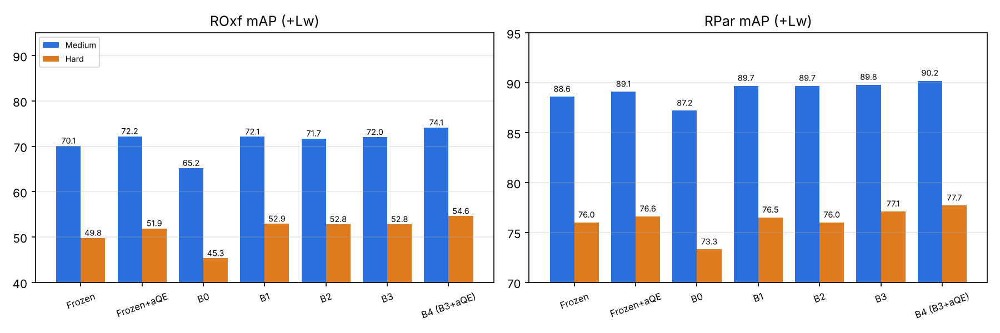

# CBIR: Landmark Retrieval with DINOv2 + GeM

A **Content-Based Image Retrieval (CBIR)** project for landmark (instance-level) retrieval.
Starting from **GeM** (Radenović et al., 2018), the CNN backbone is replaced with **DINOv2 ViT-B/14**,
then improved step by step. Each version changes **one factor** relative to the best previous version.

- **Training data:** rSfM-120k
- **Test data:** ROxford5k and RParis6k, mAP on the Medium and Hard protocols
- **Hardware:** Kaggle, T4 GPU

## Pipeline:

```
Image → DINOv2 ViT-B/14 → Global descriptor (GeM or CLS) → L2 norm → Lw whitening → Nearest-neighbor search → Query expansion (αQE)
```

## Results:

| Version | Change | ROxf Medium | ROxf Hard | RPar Medium | RPar Hard |
|---|---|:-:|:-:|:-:|:-:|
| B0 | Baseline: GeM, fine-tune last 2 blocks, lr 2e-6 | 65.2 | 45.3 | 87.2 | 73.3 |
| B1 | Train on the CLS token instead of GeM | 72.1 | 52.9 | 89.7 | 76.5 |
| B2 | Fine-tune 4 blocks instead of 2 | 71.7 | 52.8 | 89.7 | 76.0 |
| B3 | Lower learning rate to 1e-6 | 72.0 | 52.8 | 89.8 | 77.1 |
| **B4** | **B3 + αQE at test time** | **74.1** | **54.6** | **90.2** | **77.7** |
| Reference | DINOv2 paper (ViT-B/14, frozen) | 72.9 | 49.5 | 90.3 | 78.6 |

All numbers are mAP (%) with Lw whitening. B2 and B3 both branch from B1.



**Findings**
- Switching from GeM to the CLS token (B1) gives the largest gain: about +7 mAP on ROxford.
- B1, B2 and B3 perform almost the same (~72), so further training tweaks no longer help; the backbone is the limit.
- B4 adds query expansion for about +2 mAP and surpasses the original DINOv2 result on ROxford.

## Repository structure

```
src/          Python package with the full pipeline (same code as the notebooks, split into modules)
notebooks/    Kaggle notebooks for B0 to B3 (B4 is computed inside the B3 notebook)
results/      Results (csv, json) and logs for each version
automation/   Script that pushes notebooks to Kaggle and collects results
figures/      Results chart
```

## How to run

### Option 1: Kaggle notebook

1. Upload a notebook from `notebooks/` to Kaggle.
2. Enable the T4 GPU and Internet, and add the dataset `rofiqsamanhudi/rparis6k-and-roxford5k`.
3. Click **Save & Run All**. Each run takes about 5 GPU hours.

### Option 2: Python package (`src/`)

Requires a CUDA GPU, Internet access, and about 45 GB of free disk for rSfM-120k.

```bash
pip install -r requirements.txt
python -m src.run --version b3                       # train + evaluate B3
python -m src.run --version b4                       # B3 model + αQE (best result)
python -m src.run --version b0 --data-root /data/cbir
python -m src.run --version b3 --no-train            # evaluate the frozen DINOv2 backbone
```

`--version` selects the preset (b0 to b4) defined in `src/config.py`. Results are written to `outputs/<version>/results.csv`.

| Module | Content |
|---|---|
| `config.py` | Default hyperparameters and per-version presets |
| `data.py` | Dataset download, image loading, training tuples with hard-negative mining |
| `model.py` | DINOv2 backbone + GeM / CLS / average descriptors |
| `extract.py` | Single- and multi-scale descriptor extraction |
| `train.py` | Contrastive loss and fine-tuning loop (with checkpoint resume) |
| `whiten.py` | Learned whitening (Lw) |
| `qe.py` | α-weighted query expansion |
| `evaluate.py` | Revisited Oxford/Paris mAP (Easy / Medium / Hard) |
| `run.py` | End-to-end pipeline and command-line interface |
